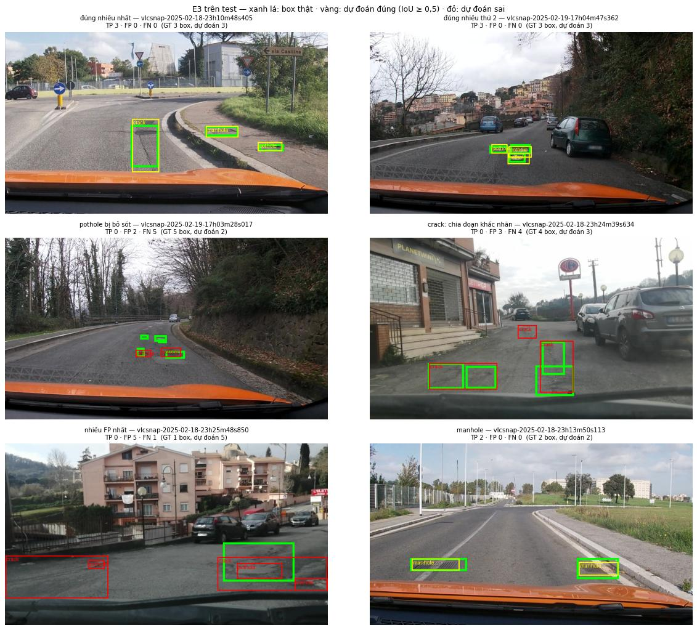
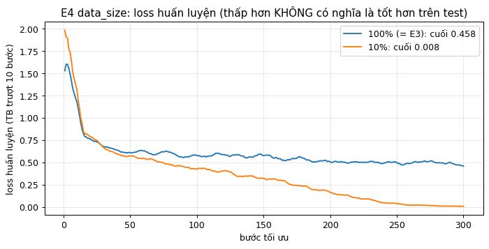

Họ tên: Bùi Đình Đề · MSSV: 2A202602818
`dataset_version`: d10-21e4070301

## Bảng tổng hợp (số của bạn, lấy từ `report/evidence/*.json`)

| Mã | Setup | Tham số huấn luyện | VRAM đỉnh (GB) | Phút | F1 | CI95 | FP/ảnh | F1 pothole | F1 crack | F1 manhole |
|---|---|---|---|---|---|---|---|---|---|---|
| E0 | zero-shot | 0 | — (suy luận 4,29) | — (suy luận 13,7) | 0,086 | 0,060–0,114 | 1,06 | 0,124 | 0,026 | 0,193 |
| E1 | LoRA LLM | 33.030.144 | 6,88 | 50,63 | 0,286 | 0,249–0,322 | 1,21 | 0,175 | 0,218 | 0,546 |
| E2 | + projector | 142.135.296 | 8,60 | 51,31 | 0,337 | 0,295–0,380 | 1,17 | 0,205 | 0,272 | 0,600 |
| E3 | + LoRA ViT | 148.426.752 | 8,79 | 60,39 | 0,442 | 0,398–0,488 | 0,83 | 0,347 | 0,361 | 0,678 |
| E4 | `data_size` = 0.1 (142 ảnh train; còn lại y hệt E3) | 148.426.752 | 8,43 | 57,08 | 0,305 | 0,271–0,342 | 1,45 | 0,205 | 0,224 | 0,601 |
| E4 | `data_size` = 1.0 (1.422 ảnh train; = chính E3) | 148.426.752 | 8,79 | 60,39 | 0,442 | 0,398–0,488 | 0,83 | 0,347 | 0,361 | 0,678 |

## 10 câu hỏi (trả lời bằng **số của bạn**, không chép lại tài liệu)

### Câu 1 — Kiến trúc: ViT, projector và LLM của Qwen3-VL-4B có bao nhiêu tham số mỗi khối, và E1/E2/E3 mỗi cái cập nhật khối nào?

**Đường đi của ảnh.** Ảnh 640×360 được cắt thành patch 16×16 và đi qua ViT gồm 24 block (hidden 1024). Projector gộp 2×2 patch thành 1 token và chiếu sang không gian 2560 chiều của LLM, nên ảnh còn **220 token**. Ngoài `visual.merger` ở đầu ra cuối, Qwen3-VL còn có **DeepStack**: 3 `deepstack_merger_list` lấy đặc trưng ở block 5, 11, 17 của ViT và bơm thẳng vào các lớp đầu của LLM. LLM có 36 layer (32 head Q, 8 head KV, MLP 9728).

**Số tham số từng khối.** Tôi đếm trên model dựng từ config gốc, ở meta device, bằng `named_parameters()`:

| Khối | Tham số | Tỉ lệ |
|---|---|---|
| ViT: patch_embed + pos_embed + 24 block | 306,2M | 6,90% |
| Projector: `visual.merger` | 27,3M | 0,61% |
| Projector: `visual.deepstack_merger_list` (3 cái) | 81,8M | 1,84% |
| LLM: `embed_tokens` (dùng chung với `lm_head`) | 389,0M | 8,76% |
| LLM: 36 layer + norm | 3.633,5M | 81,88% |
| **Tổng** | **4.437,8M** | |

Như vậy ViT kể cả projector là 415,3M, LLM kể cả embedding là 4.022,5M. `lm_head` không tốn thêm tham số vì `tie_word_embeddings = True`.

**Mỗi setup cập nhật khối nào.** Mọi setup đều đóng băng toàn bộ trọng số gốc. LLM ở dạng NF4 4-bit; ViT, projector và `lm_head` ở fp16.

| Setup | ViT | Projector | LLM | Module LoRA | Tham số huấn luyện |
|---|---|---|---|---|---|
| E1 | đóng băng | đóng băng | LoRA r=16 trên q,k,v,o,gate,up,down | 252 | **33,03M** (0,74%) |
| E2 | đóng băng | **huấn luyện đầy đủ**, fp32 | LoRA như E1 | 252 | **142,14M** (3,20%) = 33,03M + 109,11M |
| E3 | **LoRA** trên attn.qkv, attn.proj, mlp.linear_fc1/2 của 24 block | huấn luyện đầy đủ, fp32 | LoRA như E1 | 348 | **148,43M** (3,34%) = 33,03M + 6,29M + 109,11M |

Một chi tiết tôi phải xử lý: `merger` và `deepstack_merger_list` cũng có lớp tên `linear_fc1`/`linear_fc2`. Vì vậy biểu thức chọn module LoRA của ViT phải giới hạn trong `model.visual.blocks.N.`; nếu không, LoRA sẽ bị gắn nhầm vào projector. Kiểm chứng: số module khớp 252/252/348, và E2 − E1 = 109,1M, đúng bằng số tham số projector.

Điều đáng chú ý là projector rất nhỏ (2,5% model) nhưng ở E2 lại chiếm **77%** số tham số huấn luyện, vì nó được mở toàn bộ, trong khi LLM 4B chỉ thêm 33M tham số LoRA.

### Câu 2 — E0: `parse_valid_rate` bằng bao nhiêu, và hai lỗi phổ biến nhất của model gốc là gì (kèm một ví dụ output thô)?

**`parse_valid_rate` = 0,929**: 289/311 output đọc được, 22 ảnh JSON hỏng. Model gốc tuân thủ định dạng khá tốt: không bọc ```json, không có chữ thừa, không có nhãn ngoài 3 lớp. Nhưng nội dung thì sai: F1 = **0,086** (CI95 0,060–0,114), P = 0,111, R = 0,070. Model dự đoán 370 box, chỉ **41 TP** so với 583 box thật (329 FP, 542 FN).

Tôi đã loại trừ lỗi **sai thang**: toạ độ dự đoán nằm trong x ∈ [0, 1000], y ∈ [276, 1000] (y vượt 360, nên không phải pixel). Chấm lại với `--coord pixel` thì F1 rơi về 0,000, còn với `norm1000` là 0,086. Vậy model gốc **đã dùng đúng thang 0–1000**.

**Lỗi 1: bỏ sót vật thể (recall 0,070).** 110/311 ảnh có ít box hơn nhãn, 5 ảnh trả `[]` dù có hư hại. Thường model chỉ trả **một box** cho cả ảnh. Ví dụ `vlcsnap-00200`:
```
GT : [{"label":"crack","bbox_2d":[352,642,534,728]},{"label":"manhole","bbox_2d":[894,756,1000,847]}]
raw: [{"label": "crack", "bbox_2d": [750, 638, 850, 684]}]
```
Nắp cống bị bỏ qua hoàn toàn, còn box crack nằm sai chỗ (IoU = 0).

**Lỗi 2: box sai kích thước so với quy ước gán nhãn (IoU < 0,5 dù tìm đúng chỗ).** Lỗi này có hai dạng ngược nhau:
- *Crack: box khổng lồ phủ cả mặt đường.* `vlcsnap-00203` dự đoán `[0, 476, 1000, 999]` (rộng 1000 × cao 523) cho một vết nứt có nhãn `[322,631,759,775]` (437 × 144), IoU = 0,12. Crack chiếm 244/370 box dự đoán nhưng F1 crack chỉ 0,026: model coi "mặt đường nứt" là một vùng lớn, còn người gán nhãn chia vết nứt thành từng đoạn.
- *Manhole: đúng vị trí nhưng box quá dẹt.* `vlcsnap-00202` dự đoán `[309, 684, 399, 714]`, nhãn là `[275,672,405,722]`: chiều cao 30 so với 50, IoU = **0,415**. Ở `vlcsnap-00204`, chiều cao 30 so với 56, IoU = 0,347. Model nhận ra nắp cống (F1 manhole 0,193, cao nhất trong 3 lớp) nhưng vẽ box sát hơn quy ước của bộ nhãn, nên trượt ngưỡng IoU 0,5.

**Về 22 JSON hỏng.** Cả 22 đều **bị cắt giữa chừng** (chưa đóng `]`). Ô phân tích cũng đếm được 20 ảnh **lặp lại cùng một box**. Model rơi vào vòng lặp sinh mãi một box cho đến khi chạm `max_new_tokens` = 256. Trong khi đó, đáp án đúng dài nhất trên test chỉ 196 token, nên đây là lỗi của model chứ không phải do giới hạn quá chặt.

**Kết luận.** Model gốc *biết* hư hại nằm ở nửa dưới ảnh (y ≥ 276) và nhận ra được nắp cống. Nhưng nó không biết **quy ước của bộ nhãn này**: liệt kê từng vật thể, chia vết nứt thành đoạn, box ôm rộng bao nhiêu. Đó đúng là thứ finetune cần dạy. Mốc rubric là E1 phải đạt F1 ≥ 0,086 + 0,10 = 0,186; kết quả E1 đạt **0,286** (+0,200), và `parse_valid_rate` tăng từ 0,929 lên 0,997.

### Câu 3 — Thang 0–1000: nếu chấm output theo pixel (hoặc ngược lại) thì F1 ra sao và vì sao? Bạn đã kiểm chứng điều này thế nào?

**Kiểm chứng.** Tôi tạo "đáp án hoàn hảo" từ chính nhãn test (311 ảnh, 583 box) theo hai thang, rồi chấm bằng `scripts/score.py` (hàm `evaluate`) với cả hai giá trị `--coord`:

| Nhãn sinh theo | Chấm với `--coord` | F1 | mean IoU | FP/ảnh |
|---|---|---|---|---|
| norm1000 | norm1000 | **1,000** | 0,988 | 0,00 |
| pixel | pixel | **1,000** | 1,000 | 0,00 |
| norm1000 | pixel | **0,000** | 0,000 | 1,87 |
| pixel | norm1000 | **0,000** | 0,000 | 1,87 |

Cùng một bộ box đúng tuyệt đối, chỉ cần đọc sai thang là F1 rơi từ 1,0 xuống **0**. Cả 583 box thành FP (583/311 = 1,87 FP/ảnh), và cả 583 box thật thành FN.

**Vì sao.** Khi đáp án ở thang 0–1000 bị đọc như pixel, trọng tài chia x cho 640 và y cho 360 rồi nhân 1000. Kết quả là box bị **kéo giãn và đẩy xa gốc toạ độ**: ×1,56 theo chiều ngang, ×2,78 theo chiều dọc. Box thật ở giữa ảnh, khoảng y = 500, bị đẩy ra ngoài khung (y ≈ 1390). Box dự đoán và box thật không còn chồng nhau, IoU = 0 < 0,5, nên không có TP nào. Chiều ngược lại cũng vậy: box bị co về phía góc trên trái. Lỗi này nguy hiểm vì JSON vẫn **hợp lệ** (`parse_valid_rate` = 1), chỉ F1 sụp. Nhìn riêng độ hợp lệ của output sẽ không phát hiện ra.

**Round-trip.** Tôi đổi nhãn YOLO → JSON 0–1000 → `parse_output` của trọng tài → pixel trên toàn bộ 4.737 box. Sai số lớn nhất là **0,32 px**, đúng bằng sai số làm tròn lý thuyết 640/1000/2. Vẽ chồng box gốc và box quy ngược lên ảnh (ô 2b của notebook), hai box khít nhau. Mean IoU 0,988 (thay vì 1,0) cho thấy nhãn gốc được vẽ trên lưới pixel nguyên, và làm tròn sang lưới 0–1000 làm lệch nhẹ các box nhỏ. Mức lệch này vẫn xa ngưỡng 0,5.

**Kiểm chứng trên output thật của model.** Tôi chấm lại output E0 với cả hai thang: `--coord norm1000` cho F1 = 0,086, còn `--coord pixel` cho F1 = **0,000**. Toạ độ y của E0 đi tới 1000, vượt chiều cao 360 px. Vậy model gốc đã dùng đúng thang 0–1000, và nếu chấm nhầm thang thì ngay cả phần nó làm đúng cũng mất sạch. Tất cả bằng chứng E0–E4 đều được chấm với `norm1000`, khớp với nhãn huấn luyện và prompt.

**Vì sao Qwen3-VL dùng 0–1000 chứ không dùng pixel.** Qwen3-VL đổi kích thước ảnh động trước khi đưa vào ViT (patch 16 px, gộp 2×2), nên "pixel" mà model nhìn thấy phụ thuộc độ phân giải đầu vào. Toạ độ tương đối 0–1000 thì không đổi dù ảnh 640×360 hay 1920×1080. Ngoài ra, dữ liệu grounding lúc tiền huấn luyện dùng thang này, nên giữ đúng thang là tận dụng được kiến thức sẵn có của model thay vì bắt model học lại.

### Câu 4 — Mask loss: vì sao chỉ tính loss trên phần trả lời? Điều gì xảy ra nếu tính trên cả prompt và token ảnh?

**Cách tôi mask.** Mỗi ví dụ là một hội thoại `user: [ảnh] + PROMPT` → `assistant: JSON`. Tôi mã hoá hai lần bằng `apply_chat_template`: một lần chỉ có phần user (kèm `add_generation_prompt=True`), một lần có cả câu trả lời. Sau đó tôi kiểm tra chuỗi đầu là **tiền tố** của chuỗi sau, rồi gán `labels = -100` cho toàn bộ tiền tố. Ký tự `\n` sau `<|im_end|>` cũng được gán -100, vì model dừng ngay ở `<|im_end|>`. Phần đệm trong batch cũng có `labels = -100`.

**Kiểm chứng trên dữ liệu của tôi:**
- Ảnh 640×360 cho đúng **220** token `<|image_pad|>`.
- Giải mã riêng các token có `labels != -100` ra đúng `[{"label":"crack","bbox_2d":[430,467,583,506]},…]<|im_end|>`, khớp từng ký tự với `objects_to_answer` cộng `<|im_end|>`.
- Ví dụ đầu tiên dài 609 token: prompt 359 (220 ảnh + 139 chữ), câu trả lời 249, 1 token đuôi.

**Tỉ lệ token.** Trên 1.422 ảnh train, prompt **luôn dài 359 token** (cùng kích thước ảnh, cùng câu hỏi). Câu trả lời trung bình chỉ **70 token** (dài nhất 366), chuỗi trung bình 430 token. Như vậy loss chỉ tính trên trung bình **16,3%** số token. Nếu không mask, khoảng **84%** số token đóng góp vào loss là những thứ không cần học.

**Vì sao chỉ tính loss trên câu trả lời.** Khi suy luận, model chỉ *sinh* phần sau `<|im_start|>assistant`. Prompt và ảnh luôn là *đầu vào* có sẵn, không bao giờ phải sinh. Vì vậy mục tiêu học phải là P(câu trả lời | ảnh, prompt), không phải xác suất của cả chuỗi.

**Nếu tính loss trên cả prompt và token ảnh thì sao:**
1. *Tín hiệu bị pha loãng.* Loss là trung bình trên mọi token có nhãn. Khi 84% token là prompt, phần trả lời chỉ chiếm khoảng 16% trọng số của gradient. Cùng lr và 300 bước, model học nhiệm vụ thật chậm hơn nhiều.
2. *Loss "giảm đẹp" nhưng vô nghĩa.* 139 token chữ của prompt giống hệt nhau ở mọi ví dụ, nên model thuộc lòng rất nhanh. Còn 220 token ảnh thì nhãn luôn là `<|image_pad|>`, đoán đúng là việc tầm thường. Đường loss giảm nhanh, tạo cảm giác model đang học, trong khi F1 grounding hầu như không đổi. Đây là kiểu lỗi đánh lừa người theo dõi loss.
3. *Học sai hành vi.* Model bị dạy để "viết tiếp" phần câu hỏi và chuỗi `<|image_pad|>`, vốn là các vị trí mà đặc trưng ảnh được chèn vào thay cho embedding chữ. Điều này làm nhiễu đúng phần LLM đọc ảnh, và có thể khiến model sinh ra văn bản kiểu prompt thay vì JSON.

**Vì sao phải giữ `<|im_end|>` trong phần có loss.** Ở E0, 22/311 output bị cắt vì model lặp một box đến khi chạm 256 token. Học token `<|im_end|>` ngay sau dấu `]` là cách dạy model **dừng đúng lúc**. Kết quả xác nhận điều này: `parse_valid_rate` tăng từ 0,929 (E0) lên **0,997** (E1, chỉ 1/311 output hỏng) và **1,000** (E2, E3, E4). Đáp án test dài nhất chỉ 196 token, nên model không còn chạm giới hạn 256 token.

### Câu 5 — Vì sao không thể huấn luyện đầy đủ projector nếu ViT bị lượng tử hoá 4-bit, và bạn đã xử lý thế nào? Vì sao projector phải ở float32?

**Vì sao không huấn luyện đầy đủ được khi bị lượng tử hoá.** Projector (`visual.merger`, `visual.deepstack_merger_list`) nằm *bên trong* module `visual`. Nếu `visual` bị bitsandbytes lượng tử hoá, mỗi `nn.Linear` thành `Linear4bit`. Trọng số khi đó là `Params4bit` kiểu **uint8** đã nén (2 giá trị NF4 trong 1 byte, kèm hệ số scale theo khối). Tensor số nguyên không có gradient, nên không thể bật `requires_grad`, và optimizer không có gì để cập nhật. Cách duy nhất là gắn adapter (LoRA) lên trên, nhưng đó không còn là "huấn luyện đầy đủ" 109M tham số như E2/E3 yêu cầu. Kể cả nếu giải nén ra, cập nhật rồi nén lại, thì mọi bước cập nhật nhỏ hơn khoảng cách giữa hai mức NF4 (chỉ có 16 mức) sẽ bị làm tròn mất.

**Cách tôi xử lý, và một lỗi tôi đã gặp.** Theo GUIDE, tôi dùng `llm_int8_skip_modules=["visual", "lm_head"]`. Nhưng ô kiểm tra của tôi in ra **104 `Linear4bit` (uint8) trong `visual`**: ViT vẫn bị lượng tử hoá. Đọc mã nguồn transformers 5.19 (`quantizers_utils.should_convert_module`), tôi thấy tên module chỉ được so khớp từ **đầu chuỗi** (`re.match`) hoặc theo **đuôi**. Tên thật là `model.visual.blocks.0.attn.qkv`, không bắt đầu bằng `visual`, nên không khớp; `lm_head` khớp vì tên đúng bằng `lm_head`. Tôi sửa thành `['model.visual', 'lm_head']`, và từ đó ô nạp model luôn `assert` rằng cả 104 `Linear` của ViT là fp16, còn 252 `Linear` của LLM là `Linear4bit`. Không có bước kiểm tra này, E0/E1 vẫn chạy bình thường, và lỗi chỉ lộ ra (rất khó đoán nguyên nhân) ở E2/E3.

**Vì sao projector phải ở float32.** Tôi huấn luyện bằng autocast fp16: phép nhân ma trận chạy ở fp16, nhưng **bản trọng số gốc mà optimizer cập nhật là fp32**. Có ba lý do:
1. *Cập nhật bị làm tròn mất.* fp16 chỉ có 10 bit phần định trị. Với một trọng số cỡ 0,02, bước nhỏ nhất biểu diễn được là 2⁻¹⁶ ≈ 1,5·10⁻⁵. Bước cập nhật của AdamW xấp xỉ lr; khi lr của lịch cosine giảm dần về 0 ở cuối (dưới khoảng 10⁻⁵), cộng vào trọng số fp16 sẽ **không làm thay đổi gì**. Projector được huấn luyện *đầy đủ*, nên mọi trọng số đều chịu vấn đề này.
2. *Moment thứ hai của Adam bị tràn dưới.* v ≈ g². Với gradient cỡ 10⁻⁴, g² = 10⁻⁸ nhỏ hơn số dương nhỏ nhất của fp16 (≈ 6·10⁻⁸), nên v về 0, và bước m/√v bị khuếch đại sai.
3. *GradScaler yêu cầu fp32.* `scaler.unscale_` báo lỗi khi gặp gradient fp16. Vì vậy `apply_setup` của tôi đưa **mọi** tham số huấn luyện về fp32 (cả LoRA và projector), và kiểm tra lại: "mọi tham số huấn luyện fp32: True" cho E1/E2/E3.

**Cái giá đo được.** 109,1M tham số projector ở fp32 cần 0,44 GB trọng số + 0,44 GB gradient + 0,87 GB cho hai moment của Adam, tổng ≈ 1,75 GB. VRAM đỉnh đo được của E2 là 8,60 GB, so với E1 là 6,88 GB, tức **+1,72 GB**, khớp với ước tính. Khi suy luận, tôi nạp lại projector đã huấn luyện vào model fp16 (ép về fp16) và kiểm tra trọng số thực sự khác bản gốc. Bước này cần vì `peft.save_pretrained` chỉ lưu LoRA, nên projector phải được lưu riêng (`projector.pt`).

### Câu 6 — Split theo phiên quay: vì sao chia ngẫu nhiên sẽ cho F1 cao giả? Số ảnh và số box từng lớp ở mỗi split là bao nhiêu?

Số liệu tôi đo được sau `prepare_data.py` (`dataset_version` d10-21e4070301):

| Split | Ảnh | Phiên quay | Box | pothole | crack | manhole | Ảnh không box |
|---|---|---|---|---|---|---|---|
| train | 1422 | 13 | 3515 | 1074 | 1750 | 691 | 0 |
| val | 276 | 2 | 639 | 66 | 470 | 103 | 0 |
| test | 311 | 3 | 583 | 121 | 299 | 163 | 0 |

Kiểm tra rò rỉ: số phiên chung giữa train–val, train–test, val–test đều bằng 0; không `image_id` nào xuất hiện ở hai split.

**Vì sao chia ngẫu nhiên cho F1 cao giả.** 2009 ảnh chỉ đến từ 18 phiên quay, trung bình khoảng 110 frame mỗi phiên, cắt từ cùng một video. Hai frame liền nhau cách nhau vài giây nên gần như trùng: cùng con đường, cùng ánh sáng, cùng ổ gà, chỉ dịch vài pixel. Ví dụ hai ảnh val `vlcsnap-2025-02-18-18h30m26s925` và `18h32m52s770` cùng phiên `vlc-2025-02-18-18`, cùng đoạn đường. Nếu chia ngẫu nhiên, gần như mỗi ảnh test đều có một "bản sao" trong train. Model chỉ cần nhớ vị trí box của cảnh đó là đạt IoU ≥ 0,5, nên F1 đo được là khả năng **nhớ**, không phải khả năng **khái quát** sang con đường mới. Khi dùng thật, mọi ảnh đều từ con đường chưa thấy, nên F1 thật sẽ thấp hơn nhiều so với con số báo cáo. Val cũng bị rò rỉ theo, nên mọi lựa chọn dựa trên val (số bước, rank) đều bị chọn lệch theo hướng thuộc lòng.

**Cái giá của việc chia theo phiên.** Không kiểm soát được phân bố lớp. Val chỉ có 66 pothole so với 470 crack, nên tôi chỉ dùng val để gỡ lỗi, không dùng để so sánh setup. Thêm nữa, test chỉ gồm **3 phiên**, nên 311 ảnh không phải 311 mẫu độc lập: các frame trong cùng phiên tương quan mạnh. Vì vậy CI95 tính theo từng ảnh có thể hẹp hơn độ bất định thật (xem Câu 8).

### Câu 7 — So sánh E1/E2/E3: mở projector và LoRA trên ViT có đáng không (F1, CI95, VRAM, thời gian)?

Cả ba setup có cùng dữ liệu, cùng 300 bước, batch hiệu dụng 8, lr 2e-4, seed 42, và chạy trên cùng một T4:

| | F1 | CI95 | P / R | TP / FP / FN | FP/ảnh | Tham số huấn luyện | VRAM đỉnh | Phút | Loss 10 bước cuối |
|---|---|---|---|---|---|---|---|---|---|
| E1 | 0,286 | 0,249–0,322 | 0,298 / 0,274 | 160 / 377 / 423 | 1,21 | 33,0M | 6,88 GB | 50,6 | 0,555 |
| E2 | 0,337 | 0,295–0,380 | 0,346 / 0,329 | 192 / 363 / 391 | 1,17 | 142,1M | 8,60 GB | 51,3 | 0,509 |
| E3 | **0,442** | **0,398–0,488** | **0,480 / 0,410** | 239 / 259 / 344 | **0,83** | 148,4M | 8,79 GB | 60,4 | 0,458 |

**Mở projector (E1 → E2): có lợi, nhưng ít.** F1 tăng 0,052 (thêm 32 TP). Nhìn hai CI95 riêng lẻ thì chúng **chồng nhau** (E2 thấp nhất 0,295 < E1 cao nhất 0,322). Nhưng bootstrap **ghép cặp** trên cùng 311 ảnh cho hiệu ΔF1 = +0,052, CI95 [+0,015, +0,089], P(Δ ≤ 0) = 0,003, nên lợi ích là có thật, dù nhỏ (xem Câu 8). E2 cũng hơn E1 ở **cả 3 phiên quay** test. Cái giá: gấp 4,3 lần số tham số huấn luyện (+109M) và **+1,72 GB VRAM**, nhưng thời gian gần như không đổi (+0,7 phút). Lý do thời gian gần như không đổi: gradient chỉ cần đi qua projector, không phải đi ngược vào ViT.

**Thêm LoRA cho ViT (E2 → E3): đáng nhất.** F1 tăng 0,105, và CI95 **tách hẳn** (E3 thấp nhất 0,398 > E2 cao nhất 0,380). Cùng lúc precision tăng từ 0,346 lên 0,480 và FP/ảnh giảm từ 1,17 xuống 0,83: model vừa tìm được nhiều hơn vừa bịa ít hơn. Cái giá rất nhỏ: +6,3M tham số, +0,19 GB VRAM, và **+9,1 phút (+18%)**. Thời gian tăng vì giờ phải lan truyền ngược qua 24 block của ViT (gradient checkpointing tính lại activation).

**Cách tôi hiểu.** E1 và E2 chỉ thay đổi cách LLM *đọc*, hoặc cách projector *chiếu*, các đặc trưng mà ViT đông cứng đã trích ra. Nếu ViT gốc không giữ đủ chi tiết cho những vật thể chỉ khoảng 30×30 pixel (ổ gà, nắp cống), thì không lớp nào phía sau khôi phục lại được. Chỉ E3 cho phép ViT *thay đổi đặc trưng nó trích ra*. Lớp hưởng lợi nhiều nhất cũng là lớp nhỏ nhất: pothole tăng từ 0,205 lên 0,347 (+69%), so với crack tăng từ 0,272 lên 0,361 và manhole từ 0,600 lên 0,678.

**Kết luận: E3 đáng đồng tiền nhất.** E3 so với E1 cho thêm 0,156 F1 (ghép cặp: CI95 [+0,114, +0,200]) với giá +1,91 GB VRAM (vẫn chỉ dùng 8,79/15,6 GB của T4) và +10 phút. Hạn chế: mỗi setup chỉ chạy **một seed**, nên tôi chưa đo được độ dao động do huấn luyện; CI95 ở đây chỉ phản ánh dao động do mẫu test.

### Câu 8 — Tập test có 311 ảnh: khoảng tin cậy rộng thế nào, và điều đó giới hạn kết luận so sánh các setup ra sao?

**CI95 được tính thế nào.** `score.py` tính bằng bootstrap: lấy mẫu có hoàn lại 311 *ảnh* (giữ nguyên TP/FP/FN của từng ảnh), tính lại F1 micro 1.000 lần, rồi lấy phân vị 2,5% và 97,5%.

| | F1 | CI95 | Độ rộng | ≈ ± |
|---|---|---|---|---|
| E0 | 0,086 | 0,060–0,114 | 0,054 | ±0,027 |
| E1 | 0,286 | 0,249–0,322 | 0,073 | ±0,037 |
| E2 | 0,337 | 0,295–0,380 | 0,085 | ±0,043 |
| E3 | 0,442 | 0,398–0,488 | 0,090 | ±0,045 |

Mỗi F1 có sai số khoảng **±0,04**, tức gần bằng cả khoảng chênh giữa hai setup liền kề. CI rộng dần theo F1 vì gần F1 = 0,5 thì F1 dao động mạnh nhất theo việc ảnh nào được rút.

**Kết luận nào đứng vững, kết luận nào không:**
- E0 < E1 < E3, và E2 < E3: CI **không chồng nhau**, nên chắc chắn. Khoảng cách E0 → E1 (+0,200) gấp khoảng 5 lần nửa độ rộng CI.
- **E1 < E2: so CI riêng lẻ thì chưa kết luận được** (0,249–0,322 và 0,295–0,380 chồng nhau). Kiểm định ghép cặp thì cho thấy có khác biệt (bảng dưới).
- **F1 từng lớp còn kém chắc chắn hơn**, vì mỗi lớp chỉ có 121 (pothole), 299 (crack) hoặc 163 (manhole) box. Ví dụ pothole E1 → E2 (0,175 → 0,205) chỉ là thêm 7 TP, và tôi không coi đó là bằng chứng.

**Vì sao thực tế còn bất định hơn con số CI.**
1. *Ảnh không độc lập, và test bị một phiên chi phối.* 311 ảnh test chỉ đến từ **3 phiên quay**, phân bố rất lệch: `vlc-2025-02-18-23` có **213 ảnh (68%)**, `vlc-2025-02-19-17` có 83 ảnh, `num-4` chỉ có 15 ảnh. Bootstrap theo ảnh giả định 311 mẫu độc lập, nên **đánh giá thấp** độ bất định thật. F1 theo từng phiên (ô 7b):

| | num-4 (15 ảnh) | 02-18-23 (213 ảnh) | 02-19-17 (83 ảnh) |
|---|---|---|---|
| E0 | 0,000 | 0,101 | 0,064 |
| E1 | 0,318 | 0,307 | 0,235 |
| E2 | **0,553** | 0,329 | 0,326 |
| E3 | 0,444 | **0,438** | **0,451** |

E3 hơn E2 rõ ở hai phiên lớn (+0,11 và +0,13) nhưng **thua ở phiên num-4** (0,444 so với 0,553). Với chỉ 15 ảnh thì đây có thể là nhiễu, nhưng nó cho thấy thứ hạng có thể đổi theo con đường. Kết luận "E3 tốt nhất" thực chất chủ yếu dựa trên một đoạn đường (02-18-23). Muốn khẳng định cho đường mới, cần test có nhiều phiên hơn.
2. *Một seed huấn luyện.* CI chỉ phản ánh dao động do mẫu test, không phản ánh dao động do khởi tạo LoRA, dropout hay thứ tự dữ liệu. Chạy lại E1 với seed khác có thể dịch F1 vài phần trăm.
3. *Chồng CI là quy tắc bảo thủ.* Các setup được chấm trên *cùng* 311 ảnh: ảnh khó với E1 thì cũng khó với E2. So hai CI riêng lẻ là bỏ qua tương quan này. Ở ô 7b, tôi chạy **bootstrap ghép cặp**: mỗi lần rút cùng một tập 311 ảnh cho cả hai setup rồi tính *hiệu* F1, lặp 2.000 lần:

| So sánh | ΔF1 | CI95 của ΔF1 | P(Δ ≤ 0) |
|---|---|---|---|
| E1 − E0 | +0,200 | [+0,162, +0,238] | 0,000 |
| **E2 − E1** | **+0,052** | **[+0,015, +0,089]** | **0,003** |
| E3 − E2 | +0,105 | [+0,064, +0,146] | 0,000 |
| E3 − E1 | +0,156 | [+0,114, +0,200] | 0,000 |

Khi ghép cặp, phần dao động chung (độ khó của từng ảnh) triệt tiêu, nên CI của hiệu chỉ rộng khoảng ±0,04, thay vì phải so hai khoảng ±0,04 với nhau. Nhờ vậy E2 > E1 trở thành có ý nghĩa. Bài học: "CI chồng nhau" **không có nghĩa** "không khác nhau".

**Hệ quả với cách tôi kết luận.** Tôi tin chắc E0 < E1 < E3 và E2 < E3: hiệu lớn, CI ghép cặp xa 0, và đúng ở các phiên lớn. E1 < E2 có ý nghĩa theo kiểm định ghép cặp, nhưng hiệu nhỏ (+0,05), lại chịu hai nguồn bất định chưa đo (ảnh tương quan theo phiên, một seed), nên tôi chỉ gọi đó là "cải thiện nhỏ". Mọi so sánh theo lớp và E4 tôi đều đọc kèm CI ghép cặp, không chỉ nhìn F1.

### Câu 9 — Phân tích lỗi theo lớp: lớp nào kém nhất và vì sao (kích thước box, số mẫu, ngữ nghĩa)? Kèm ảnh minh hoạ.

Số liệu theo lớp của setup tốt nhất (E3) trên test, cùng đặc điểm dữ liệu đo ở CP1:

| Lớp | F1 E0 → E1 → E2 → E3 | P / R (E3) | TP / FP / FN (E3) | Box train | Diện tích trung vị | ≈ Cạnh box (px) |
|---|---|---|---|---|---|---|
| pothole | 0,124 → 0,175 → 0,205 → **0,347** | 0,39 / 0,31 | 38 / 60 / 83 | 1.074 | **0,38%** | ≈ 30 |
| crack | 0,026 → 0,218 → 0,272 → 0,361 | 0,38 / 0,35 | 104 / 173 / 195 | 1.750 | 1,42% | ≈ 57 |
| manhole | 0,193 → 0,546 → 0,600 → **0,678** | 0,79 / 0,60 | 97 / 26 / 66 | **691** | 0,46% | ≈ 33 |

**Pothole kém nhất (F1 0,347), và nguyên nhân chính là kích thước.** Box pothole trung vị chỉ chiếm 0,38% khung hình, tức khoảng 875 px², cạnh cỡ 30 px trên ảnh 640×360. Qwen3-VL cắt patch 16 px rồi gộp 2×2, nên **mỗi token ảnh phủ 32×32 px**: một ổ gà điển hình chỉ nằm gọn trong **khoảng 1 token**. Model phải định vị chính xác tới mức dưới một token. Lệch 10 px trên một box 30×30 đã làm IoU tụt xuống khoảng 0,5, nên một dự đoán "đúng chỗ" vẫn bị tính là cả FP lẫn FN. Đây cũng là lý do E3 (LoRA trên ViT, cho phép thay đổi đặc trưng ở mức patch) giúp pothole nhiều nhất: +69% so với E2.

**Số mẫu không giải thích được thứ hạng.** Manhole có **ít box train nhất** (691, so với 1.074 của pothole) nhưng tốt nhất. Box manhole cũng nhỏ (0,46%) nhưng **ngữ nghĩa rõ ràng**: nắp cống tròn, bằng kim loại, viền rõ, hình dạng gần như giống hệt nhau giữa các ảnh. Model gốc cũng đã nhận ra được (F1 E0 0,193, cao nhất). Precision manhole ở E3 là 0,79: khi model nói "nắp cống" thì gần như luôn đúng; lỗi chủ yếu là bỏ sót (FN 66).

**Crack khó vì ranh giới mơ hồ, không phải vì nhỏ.** Box crack lớn nhất (1,42%), nhiều mẫu nhất (1.750), nhưng F1 chỉ 0,361 với FP cao nhất (173). Một vết nứt dài có thể được gán nhãn thành 1 box dài hoặc 3 box ngắn, tuỳ người gán. Ở E0, model vẽ một box phủ cả mặt đường (Câu 2). Sau finetune, model học được quy ước "chia đoạn", nhưng cách chia của nó vẫn khác người gán nhãn, nên IoU với từng đoạn dưới 0,5: vừa FP vừa FN dù vết nứt được tìm thấy. Ngoài ra, mảng vá, vệt nước, bóng cây trên mặt đường cũng trông giống vết nứt.

**Ảnh minh hoạ** (`report/figures/e3_examples.jpg`, sinh bởi ô 7b; xanh lá = box thật, vàng = dự đoán đúng IoU ≥ 0,5 cùng lớp, đỏ = dự đoán sai):



1. `…18-23h10m48s405`: TP 3/3. Một crack dọc, một manhole, một pothole đều khớp.
2. `…19-17h04m47s362`: TP 3/3. Ba ổ gà nhỏ nằm sát nhau vẫn được tách đúng từng cái.
3. `…19-17h03m28s017`, **pothole bị bỏ sót**: TP 0, FP 2, FN 5. Năm ổ gà chỉ khoảng 15–20 px ở xa. Model đặt 2 box *đúng vùng* nhưng lệch vài pixel, IoU < 0,5, nên vừa FP vừa FN. Đây là minh hoạ trực tiếp cho giới hạn "1 token ảnh ≈ 32 px" ở trên.
4. `…18-23h24m39s634`, **crack chia đoạn khác nhãn**: TP 0, FP 3, FN 4. Bên trái, nhãn chia vết nứt thành 2 box liền nhau, còn model vẽ 1 box dài phủ cả hai. Bên phải, nhãn có 2 box lồng nhau, model vẽ 1 box lớn. Model *thấy* vết nứt, nhưng cách cắt đoạn khác người gán nhãn.
5. `…18-23h25m48s850`, **nhiều FP nhất**: TP 0, FP 5, FN 1. Nhãn chỉ có 1 box cho cả vùng mặt đường hư hỏng; model chia thành nhiều box crack/pothole nhỏ hơn, và thêm một box crack lớn ở mép trái.
6. `…18-23h13m50s113`, **manhole**: TP 2/2. Nắp cống có hình dạng rõ, box khớp tốt.

### Câu 10 — E4: bạn đổi biến nào, kết quả thế nào, và kết luận có đáng tin không?

**Biến được đổi: `data_size`**, tức tỉ lệ ảnh train, với hai giá trị **10%** và **100%**. Mốc so sánh là setup tốt nhất **E3** (LoRA LLM + LoRA ViT + projector fp32). Bản 10% gồm 142 ảnh, rút ngẫu nhiên với seed 42 từ 1.422 ảnh train. Bản 100% chính là E3: GUIDE cho phép một giá trị trùng setup gốc, và tôi chấm lại cùng output của E3 dưới tên `e4_data_size_1.0`. Mọi thứ khác giữ nguyên: r = 16, alpha = 32, lr 2e-4, **cùng 300 bước** với batch hiệu dụng 8, cùng seed, cùng prompt và thang 0–1000. Ô 8a so `run.json` của hai bản và chỉ cho chạy tiếp khi khác nhau duy nhất ở `fraction` và `n_train_images`. Tôi cố ý **giữ nguyên số bước**, tức cùng lượng tính toán: nếu giảm số bước theo tỉ lệ dữ liệu thì sẽ đổi hai biến cùng lúc.

| data_size | Ảnh train | Số lần mỗi ảnh được thấy | F1 | CI95 | P / R | FP/ảnh | pothole | crack | manhole | Loss 10 bước cuối | VRAM | Phút |
|---|---|---|---|---|---|---|---|---|---|---|---|---|
| 0.1 | 142 | ≈ 17 | 0,305 | 0,271–0,342 | 0,292 / 0,319 | **1,45** | 0,205 | 0,224 | 0,601 | **0,008** | 8,43 | 57,1 |
| 1.0 | 1.422 | ≈ 1,7 | **0,442** | 0,398–0,488 | 0,480 / 0,410 | 0,83 | 0,347 | 0,361 | 0,678 | 0,458 | 8,79 | 60,4 |

**Kết quả.** Giảm còn 10% dữ liệu làm F1 giảm **0,137**. Bootstrap ghép cặp trên cùng 311 ảnh cho hiệu 100% − 10% = **+0,137, CI95 [+0,097, +0,177], P(Δ ≤ 0) = 0,000**, và hai CI riêng lẻ cũng không chồng nhau (0,342 < 0,398). Chênh lệch nhất quán ở **cả 3 lớp** và **cả 3 phiên quay test**: 0,316 → 0,444; 0,292 → 0,438; 0,332 → 0,451. Manhole bị ảnh hưởng ít nhất (0,601 → 0,678): hình dạng rõ nên học được từ ít ví dụ. Pothole và crack mất nhiều nhất. Dù vậy, 142 ảnh vẫn đủ để vượt xa zero-shot (10% − E0 = +0,219, CI95 [+0,182, +0,258]).

**Học thuộc (`report/figures/e4_loss.png`).** Với 142 ảnh × 300 bước, mỗi ảnh được thấy khoảng 17 lần. Loss huấn luyện của bản 10% rơi về **0,008**, gần như thuộc lòng đáp án, trong khi bản 100% dừng ở 0,458. Loss thấp hơn nhưng test kém hơn: precision giảm từ 0,480 xuống 0,292, và **FP/ảnh tăng từ 0,83 lên 1,45**. Model "nhìn thấy" lại những mẫu hư hại đã thuộc ở chỗ không có. Đây là ví dụ rõ rằng loss huấn luyện không phải thước đo chất lượng.



**Một so sánh đáng chú ý.** E3 chỉ với 10% dữ liệu (0,305) ngang với E1 dùng đủ 100% dữ liệu (0,286) và E2 (0,337); các CI chồng nhau, nên đây chỉ là xu hướng. Nói cách khác, mở ViT cho học bù lại được phần lớn lợi ích của việc có gấp 10 lần dữ liệu khi chỉ finetune LLM.

**Kết luận có đáng tin không?**
- *Hướng và độ lớn: đáng tin.* Hiệu +0,137 gấp khoảng 3 lần nửa độ rộng CI ghép cặp (±0,04), và đúng ở mọi phiên quay, mọi lớp.
- *Giới hạn:*
  1. Chỉ có **một tập con 10%** và **một seed**. Một tập 142 ảnh khác (vd. rơi vào ít phiên hơn) có thể cho F1 khác vài phần trăm, và dao động này chưa được đo.
  2. Chỉ có **hai điểm** trên đường cong dữ liệu. Tôi không biết 30% hay 50% đã đủ chưa, cũng không biết thêm dữ liệu nữa có còn giúp không. Loss của bản 100% vẫn đang giảm ở bước 300, nên 1,7 vòng dữ liệu có thể còn chưa đủ.
  3. Test bị phiên `02-18-23` chiếm 68% ảnh (Câu 8), nên "tốt hơn" được hiểu là trên những con đường giống 3 phiên này.
  4. Số bước giữ nguyên, nên kết quả trả lời câu hỏi "cùng ngân sách tính toán, ít dữ liệu thì sao". Với 10% dữ liệu mà dừng sớm hơn (ít học thuộc hơn) thì F1 có thể nhích lên.

  Kết luận tôi tin được: *với cùng lượng tính toán, 10× dữ liệu giúp rõ rệt, và ít dữ liệu dẫn tới học thuộc cùng bịa box*.

## Nhìn lại

**Lỗi tôi gặp mà công cụ chấm không bắt được.** Cả bốn lỗi đều cho ra số "hợp lệ", chỉ bị phát hiện nhờ tôi tự thêm kiểm tra:
1. **ViT bị lượng tử hoá dù đã cấu hình bỏ qua.** Với transformers 5.19, `llm_int8_skip_modules=["visual", ...]` như GUIDE không khớp tên `model.visual.*` (so khớp từ đầu chuỗi), nên 104 lớp Linear của ViT thành 4-bit. E0/E1 vẫn chạy bình thường; chỉ E2/E3 sai, và rất khó đoán nguyên nhân. `score.py` không thấy gì vì đầu ra vẫn hợp lệ. Tôi sửa thành `model.visual` và thêm `assert` sau mỗi lần nạp model.
2. **Môi trường Colab:** `torchao 0.10` cài sẵn khiến `peft 0.21.2` báo `ImportError` khi gắn LoRA. Lab không dùng torchao nên tôi gỡ đi.
3. **Số đo VRAM bị đội lên:** biến vòng lặp còn giữ `lm_head` của model cũ (khoảng 0,8 GB), làm VRAM của E0 hiện 4,29 GB. Với E1–E3, `peak_vram_gb` được đo sau `reset_peak_memory_stats()` trong một model mới nạp, nên không bị ảnh hưởng. Nhưng nếu đo cẩu thả, `meta` sẽ sai mà `check_submission.py` vẫn PASS (nó chỉ kiểm tra số dương).
4. **Rủi ro E2/E3 ≈ E1:** `peft.save_pretrained` không lưu projector. Tôi lưu riêng `projector.pt`, và khi nạp lại thì kiểm tra trọng số projector thực sự khác bản gốc.

**Về dữ liệu và cách đánh giá:**
- Test 311 ảnh chỉ từ 3 phiên, trong đó một phiên chiếm 68%. CI bootstrap theo ảnh giả định ảnh độc lập nên lạc quan hơn thực tế; xếp hạng E2/E3 còn đảo ngược ở phiên nhỏ `num-4`.
- So hai CI riêng lẻ thì bảo thủ: E1 → E2 trông "không khác", nhưng bootstrap ghép cặp cho thấy có khác biệt (P = 0,003).
- Quy ước gán nhãn crack (chia vết nứt thành từng đoạn) không nhất quán, nên một dự đoán thấy đúng vết nứt vẫn bị tính là FP + FN.
- Pothole điển hình chỉ khoảng 30 px, xấp xỉ một token ảnh 32 px, nên ngưỡng IoU 0,5 rất khắt khe với lớp này.
- Model gốc (E0) hay rơi vào vòng lặp sinh lặp lại một box đến khi bị cắt ở 256 token. Học `<|im_end|>` trong phần có loss đã đưa `parse_valid_rate` lên 0,997–1,000.

**Điều tôi chưa hiểu hết:**
- Vì sao E3 thua E2 ở phiên `num-4`: do nhiễu (chỉ 15 ảnh) hay do điều kiện đường khác?
- Trong 109M tham số projector, `merger` và `deepstack_merger_list` mỗi phần đóng góp bao nhiêu (tôi chỉ mở cả hai cùng lúc)?
- Lượng tử hoá NF4 của LLM có làm giảm độ chính xác toạ độ không?
- 300 bước đã đủ chưa: loss của E3 vẫn đang giảm ở cuối.

Để trả lời các câu này cần thêm seed, thêm phiên test, và tách riêng từng biến.

**Vận hành.** Colab miễn phí bị ngắt qua đêm (máy tự cập nhật Windows). Vòng huấn luyện của tôi lưu checkpoint (LoRA, projector, optimizer, scheduler, scaler) lên Drive mỗi 100 bước, và suy luận ghi tiếp từ ảnh dang dở. Nhờ vậy không phải chạy lại phần đã xong; tôi chỉ cần chạy nốt phần suy luận E2/E3 vào sáng hôm sau.
